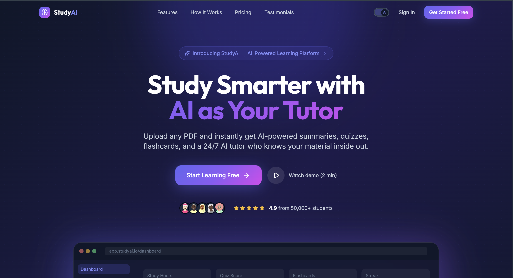
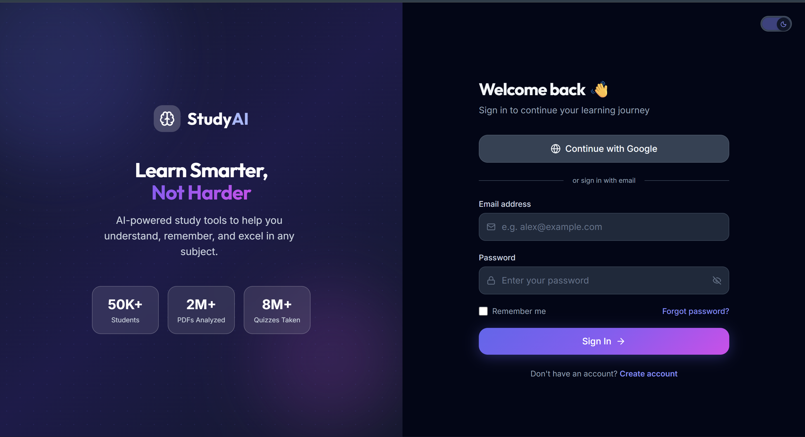
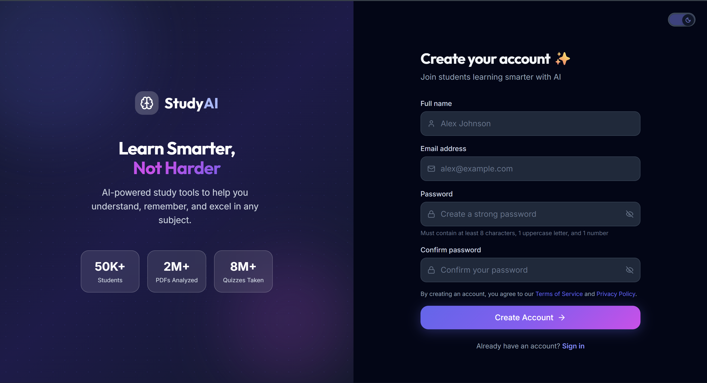
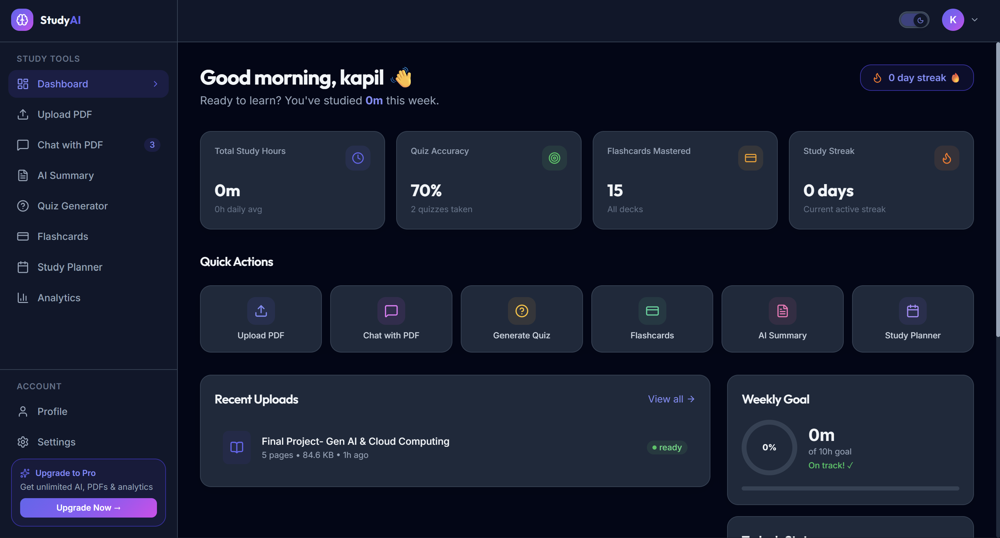
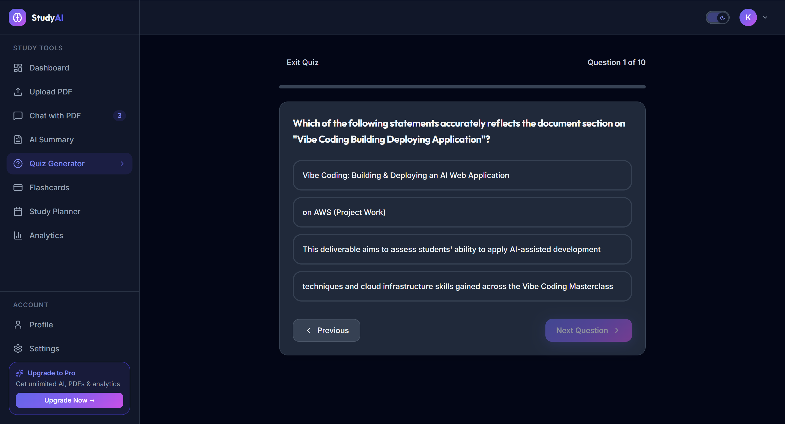
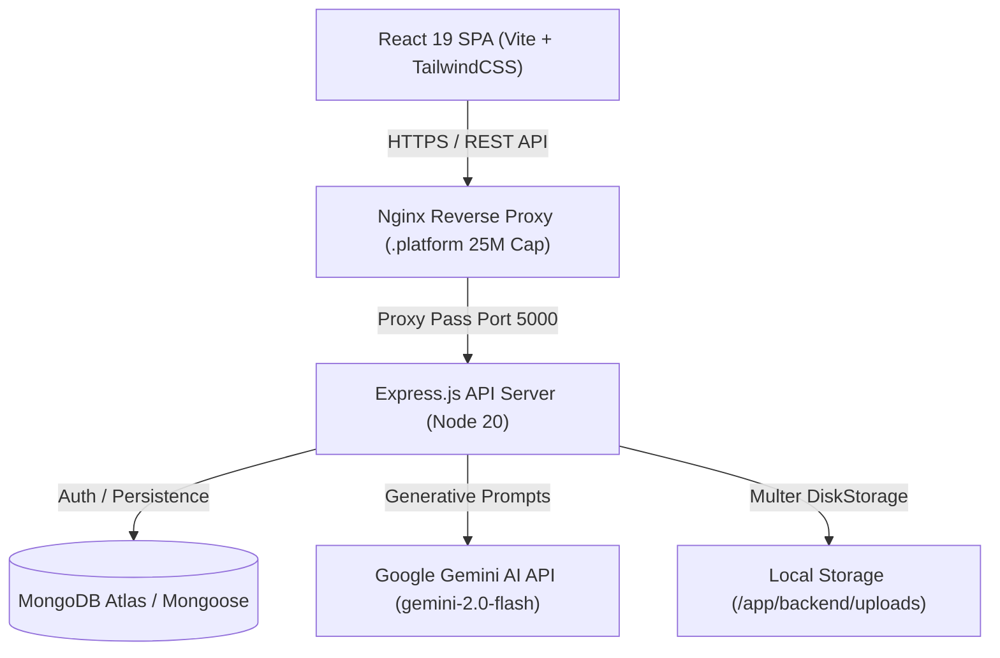

# StudyAI – AI-Powered Study Companion


**StudyAI** is an intelligent, full-stack study companion application that transforms static PDF learning materials into dynamic, interactive study tools powered by Google Gemini AI (`gemini-2.0-flash`). Students and researchers can upload documents up to **25 MB**, generate instant summaries, test active recall with multiple-choice quizzes and interactive flashcards, build customized study plans, and engage in context-grounded AI chat conversations.

---

## 🌐 Live Demo

- **Application:** http://studyai-env.eba-t79zgdqp.ap-south-1.elasticbeanstalk.com/
- **Health Check:** http://studyai-env.eba-t79zgdqp.ap-south-1.elasticbeanstalk.com/health
- **Repository:** https://github.com/kapilyadav008/Study-AI

---

## 📋 Table of Contents

- [Live Demo](#-live-demo)
- [Project Highlights](#-project-highlights)
- [Application Screenshots](#-application-screenshots)
- [System Architecture](#-system-architecture)
- [Feature Status](#-feature-status)
  - [Implemented Features](#implemented-features)
  - [Partially Implemented Features](#partially-implemented-features)
  - [Planned Features](#planned-features)
- [Tech Stack](#%EF%B8%8F-tech-stack)
- [Project Structure](#-project-structure)
- [Getting Started & Installation](#-getting-started--installation)
  - [Prerequisites](#prerequisites)
  - [Clone Repository](#clone-repository)
  - [Environment Setup](#environment-variables)
  - [Running Locally](#running-the-project)
- [Containerization & Elastic Beanstalk Deployment](#-containerization--aws-elastic-beanstalk-deployment)
- [API Reference](#-api-reference)
- [License](#-license)

---

## 🔥 Project Highlights

- 📄 **Instant PDF Ingestion & Parse Engine**: Fast document processing with a strict **25 MB** file size limit validated at both client-side and server-side boundaries.
- 🤖 **Context-Aware Gemini AI Integration**: Primary integration with `gemini-2.0-flash` featuring multi-model fallback (`gemini-1.5-flash`, `gemini-1.5-pro`) and local fallback heuristics for offline resilience.
- 🎯 **Active Recall & Spaced Repetition**: Automated MCQ quiz generation with immediate scoring, detailed answer explanations, and flashcard decks with confidence tracking (`low`, `medium`, `high`).
- 📅 **Dynamic Study Planning & Progress Analytics**: Custom task scheduling, weekly study hour tracking, and visual analytics dashboards powered by Recharts.
- 🛡️ **Enterprise Security & Cloud Deployment**: Fullstack JWT authentication, Helmet header protection, Nginx proxy cap (`client_max_body_size 25M`), Docker containerization, and AWS Elastic Beanstalk production setup.

---

## 📸 Application Screenshots

| Home | Login |
| :---: | :---: |
|  |  |

| Registration | Dashboard |
| :---: | :---: |
|  |  |

| Upload PDF | AI Chat |
| :---: | :---: |
|  |  |

| Quiz | User Profile |
| :---: | :---: |
|  |  |

---

## 🏗️ System Architecture



---

## 🎯 Feature Status

### Implemented Features

- 🔒 **User Authentication & Session Security**: User registration, bcrypt password hashing, HTTP-only JWT authentication, `/api/auth/me` session persistence, profile updates, and password management.
- 📄 **PDF Document Upload & Parsing**: Drag-and-drop interface, server-side parsing via `pdf-parse`, strict **25 MB** upload limit enforced via Frontend validation, Express payload limits (`25mb`), Multer configuration (`25MB`), and Nginx proxy cap (`25M`).
- 🤖 **Document-Grounded AI Chat Assistant**: Multi-conversation context-aware Q&A assistant trained on uploaded study materials.
- 📝 **Multi-Format AI Summarizer**: Automatic extraction of short executive summaries, bullet points, detailed section breakdowns, key concepts, and key terms.
- 🧪 **AI Quiz Generator & Evaluator**: Multiple-choice quiz generation with difficulty levels, automated score calculation, answer explanations, and attempt history tracking.
- 🎴 **Interactive Flashcards**: Automated flashcard generation, flip-card interface, term bookmarking, and confidence rating (`low`, `medium`, `high`).
- 📅 **AI Study Planner & Task Tracker**: Custom study schedule breakdown, interactive task management (To-Do, In Progress, Completed), weekly target hours, and session logging.
- 📊 **Analytics Dashboard**: Aggregated learning metrics, study time tracking, quiz score averages, and activity history.
- 🐳 **Docker & AWS Elastic Beanstalk Ready**: Production-grade multi-stage Dockerfile, `Dockerrun.aws.json`, and `.platform/nginx/conf.d/client_max_body_size.conf` configuration.

### Partially Implemented Features

- ☁️ **Cloud Storage Integration**: Architecture supports local file storage under `backend/uploads/` with modular service abstractions ready for Cloudinary/AWS S3 integration.

### Planned Features

- 🔍 **OCR Scanning**: Processing image-based PDFs and handwritten study notes via Tesseract.js or AWS Textract.
- 🎙️ **Voice Study Companion**: Speech-to-text prompt input and AI audio response generation.
- 🌐 **Multi-Language Support**: Automatic translation of summaries, quizzes, and study cards into multiple languages.

---

## 🛠️ Tech Stack

### Frontend
- **Framework**: React 19 (Single Page Application)
- **Build Tool**: Vite 8
- **Styling**: Vanilla CSS & Tailwind CSS with `@tailwindcss/typography`
- **Routing**: React Router DOM 7
- **UI Components & Icons**: Lucide React, Framer Motion, Recharts
- **HTTP Client & Toasting**: Axios & React Hot Toast

### Backend
- **Runtime**: Node.js (v20 LTS / v18+)
- **Framework**: Express.js 4.x
- **Database**: MongoDB Atlas via Mongoose ORM
- **Authentication**: JSON Web Tokens (`jsonwebtoken`) & `bcryptjs`
- **File Parsing & Ingestion**: Multer & `pdf-parse`
- **AI Integration**: Official `@google/generative-ai` SDK (`gemini-2.0-flash` with fallback handlers)
- **Middleware**: Helmet, CORS, Morgan, Cookie-Parser, Express-Validator

### Infrastructure & Deployment
- **Containerization**: Multi-stage Dockerfile (Alpine Node 20 runner)
- **Cloud Hosting**: AWS Elastic Beanstalk (Single Container Docker)
- **Reverse Proxy**: Nginx with custom `.platform/` configuration (`client_max_body_size 25M;`)

---

## 📁 Project Structure

```
StudyAI/
├── .platform/                  # AWS Elastic Beanstalk Nginx Proxy Configuration
│   └── nginx/
│       └── conf.d/
│           └── client_max_body_size.conf  # Nginx 25MB client_max_body_size cap
├── Dockerfile                  # Multi-stage production container build (Unified Fullstack)
├── Dockerrun.aws.json          # AWS Elastic Beanstalk single-container descriptor
├── README.md
├── package.json                # Workspace script orchestrator
├── package-lock.json
├── screenshots/                # Application screenshots for README documentation
│   ├── AI Chat.png
│   ├── Dashboard.png
│   ├── Home.png
│   ├── Login.png
│   ├── Quiz.png
│   ├── Registration.png
│   ├── Upload PDF.png
│   └── User Profile.png
├── backend/                    # Node.js / Express API Service
│   ├── .dockerignore
│   ├── .env.example
│   ├── .gitignore
│   ├── Dockerfile              # Standalone backend container definition
│   ├── docker-compose.yml      # Local development stack (API + Mongo + Mongo Express)
│   ├── app.js                  # Express middleware, body limits (25mb), routes & static serving
│   ├── server.js               # Application entry point & database connection
│   ├── package.json
│   ├── uploads/                # Local PDF document storage directory
│   └── src/                    # Modular source code
│       ├── config/             # MongoDB (`db.js`) & Gemini AI client (`gemini.js`)
│       ├── controllers/        # Request handlers (auth, pdf, chat, summary, quiz, planner, etc.)
│       ├── middleware/         # Auth (`protect`), validation, 404, global error handler
│       ├── models/             # Mongoose schemas (User, PDF, Conversation, Quiz, Flashcard, etc.)
│       ├── routes/             # Express API routes mounted under `/api`
│       ├── services/           # Gemini AI service, PDF parser, Multer upload service (25MB limit)
│       ├── utils/              # Helper utilities, AI prompt templates, response wrappers
│       └── validators/         # Input validators (`express-validator`)
└── frontend/                   # React 19 + Vite Frontend Application
    ├── .env.example
    ├── index.html
    ├── package.json
    ├── postcss.config.js
    ├── tailwind.config.js
    ├── vite.config.js
    └── src/
        ├── api/                # Axios instance configuration & API modules
        ├── components/         # UI component library (layout, buttons, modal, cards, progress)
        ├── context/            # AuthContext state management
        ├── layouts/            # AuthLayout & AppLayout wrappers
        ├── pages/              # UploadPDFPage (25MB pre-check), ChatPage, QuizPage, SummaryPage, etc.
        ├── routes/             # AppRoutes & ProtectedRoute definitions
        └── index.css           # Global design system & theme tokens
```

---

## 🚀 Getting Started & Installation

### Prerequisites

Ensure you have the following installed locally:
- **Node.js**: `v18.0.0` or `v20.0.0+`
- **npm**: `v9.0.0+`
- **MongoDB**: MongoDB Atlas database URI or local MongoDB instance
- **Google Gemini API Key**: Obtain a key from [Google AI Studio](https://aistudio.google.com/app/apikey)

### Clone Repository

```bash
git clone https://github.com/your-username/StudyAI.git
cd StudyAI
```

### Installation

Install dependencies across all workspaces:

```bash
npm run install-all
```

Alternatively, install backend and frontend manually:

```bash
# Backend
cd backend && npm install

# Frontend
cd ../frontend && npm install
```

---

## 🔐 Environment Variables

### Backend (`backend/.env`)

Copy `backend/.env.example` to `backend/.env` and update your keys:

```env
PORT=5000
NODE_ENV=development

# Database
MONGODB_URI=mongodb+srv://<username>:<password>@cluster.mongodb.net/AIStudy

# JWT Security
JWT_SECRET=your_jwt_secret_key_minimum_32_characters
JWT_EXPIRES_IN=7d
JWT_COOKIE_EXPIRES_IN=7

# Gemini AI API
GEMINI_API_KEY=YOUR_GEMINI_API_KEY
GEMINI_MODEL=gemini-2.0-flash

# CORS & Upload Limits
FRONTEND_URL=http://localhost:5173
MAX_FILE_SIZE_MB=25
```

### Frontend (`frontend/.env`)

Copy `frontend/.env.example` to `frontend/.env`:

```env
VITE_API_URL=http://localhost:5000/api
```

---

## 🏃 Running Locally

Run both the backend API and Vite frontend server concurrently:

```bash
npm run dev
```

- **Frontend Application**: `http://localhost:5173`
- **Backend API**: `http://localhost:5000/api`
- **Health Check**: `http://localhost:5000/health`

---

## 🐳 Containerization & AWS Elastic Beanstalk Deployment

### Single-Container Fullstack Build (Docker)

```bash
# Build unified production Docker image
docker build -t study-ai-app .

# Run container locally
docker run -d -p 5000:5000 --env-file backend/.env --name study-ai-container study-ai-app
```

### AWS Elastic Beanstalk Deployment

The repository is pre-configured for **AWS Elastic Beanstalk (Single Container Docker)**:
1. **Nginx Reverse Proxy Cap**: `.platform/nginx/conf.d/client_max_body_size.conf` sets `client_max_body_size 25M;` on the host EC2 proxy.
2. **Container Port Mapping**: `Dockerrun.aws.json` routes port `80` to container port `5000`.
3. **Deployment**: Create a zip bundle of the project root (including `.platform/`, `Dockerfile`, `Dockerrun.aws.json`, `backend/`, and `frontend/`) and deploy to Elastic Beanstalk.

---

## 📡 API Reference

All backend API routes are protected by JWT authentication (except `/api/auth/register` and `/api/auth/login`).

| Module | Method | Endpoint | Description |
| :--- | :--- | :--- | :--- |
| **Auth** | `POST` | `/api/auth/register` | Register new user account |
| **Auth** | `POST` | `/api/auth/login` | Authenticate user & issue JWT |
| **Auth** | `POST` | `/api/auth/logout` | End user session & clear cookies |
| **Auth** | `GET` | `/api/auth/me` | Fetch current user details |
| **Profile** | `GET` | `/api/profile` | Get user profile & study statistics |
| **Profile** | `PUT` | `/api/profile` | Update profile information |
| **Profile** | `PUT` | `/api/profile/password` | Change account password |
| **PDF** | `POST` | `/api/pdf` | Upload PDF document (Max 25 MB) |
| **PDF** | `GET` | `/api/pdf` | List uploaded PDF documents |
| **PDF** | `GET` | `/api/pdf/:id` | Get PDF details & processing status |
| **PDF** | `DELETE` | `/api/pdf/:id` | Delete PDF document & file from storage |
| **Chat** | `POST` | `/api/chat/conversation` | Create new PDF chat session |
| **Chat** | `GET` | `/api/chat/conversation` | List user chat conversations |
| **Chat** | `GET` | `/api/chat/conversation/:id` | Get conversation history |
| **Chat** | `DELETE` | `/api/chat/conversation/:id` | Delete chat conversation |
| **Chat** | `PUT` | `/api/chat/conversation/:id/rename` | Rename conversation |
| **Chat** | `POST` | `/api/chat/conversation/:id/message` | Send prompt to AI & receive response |
| **Summary** | `GET` | `/api/summary/:pdfId` | Fetch all generated summaries for a PDF |
| **Summary** | `POST` | `/api/summary/:pdfId/short` | Generate short executive summary |
| **Summary** | `POST` | `/api/summary/:pdfId/bullets` | Generate key bullet points |
| **Summary** | `POST` | `/api/summary/:pdfId/detailed` | Generate detailed section summary |
| **Summary** | `POST` | `/api/summary/:pdfId/concepts` | Extract key concepts |
| **Summary** | `POST` | `/api/summary/:pdfId/terms` | Extract key terms & definitions |
| **Quiz** | `POST` | `/api/quiz/generate` | Generate MCQ quiz from PDF |
| **Quiz** | `GET` | `/api/quiz` | List generated quizzes |
| **Quiz** | `GET` | `/api/quiz/:id` | Get quiz questions |
| **Quiz** | `POST` | `/api/quiz/:id/submit` | Submit quiz attempt & calculate score |
| **Quiz** | `GET` | `/api/quiz/:id/results` | Get quiz attempt history |
| **Quiz** | `DELETE` | `/api/quiz/:id` | Delete quiz |
| **Flashcards** | `POST` | `/api/flashcards/generate` | Generate flashcards from PDF |
| **Flashcards** | `GET` | `/api/flashcards` | List flashcard decks |
| **Flashcards** | `GET` | `/api/flashcards/:id` | Get deck cards & review stats |
| **Flashcards** | `DELETE` | `/api/flashcards/:id` | Delete flashcard deck |
| **Flashcards** | `PUT` | `/api/flashcards/:id/card/:cardId/bookmark` | Toggle card bookmark |
| **Flashcards** | `PUT` | `/api/flashcards/:id/card/:cardId/review` | Update card confidence level (`low`/`medium`/`high`) |
| **Planner** | `GET` | `/api/planner` | Get study planner & task schedule |
| **Planner** | `POST` | `/api/planner/task` | Create new study task |
| **Planner** | `PUT` | `/api/planner/task/:taskId` | Update task status or details |
| **Planner** | `DELETE` | `/api/planner/task/:taskId` | Delete study task |
| **Planner** | `PUT` | `/api/planner/goal` | Update weekly study hour goal |
| **Planner** | `POST` | `/api/planner/log` | Log study session |
| **Analytics** | `GET` | `/api/analytics/dashboard` | Aggregate study performance metrics |
| **Analytics** | `GET` | `/api/analytics/overview` | High-level user study summary |
| **Analytics** | `POST` | `/api/analytics/activity` | Log custom activity event |

---

## 📄 License

This project is open-source and licensed under the **MIT License**.
